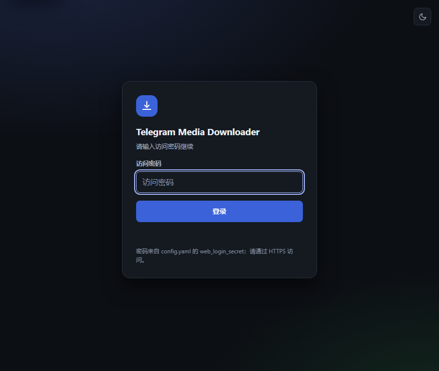
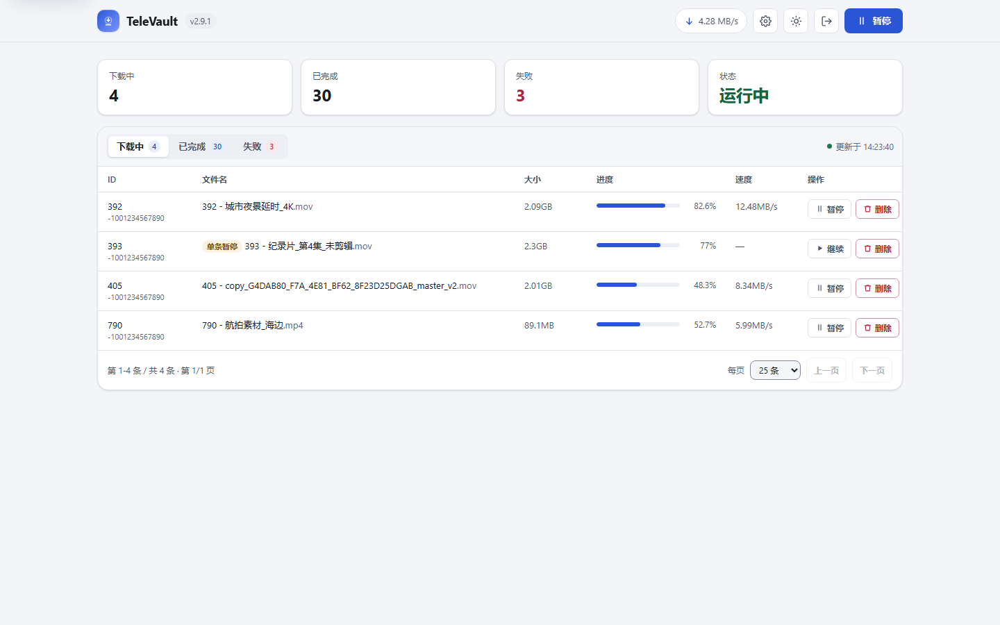
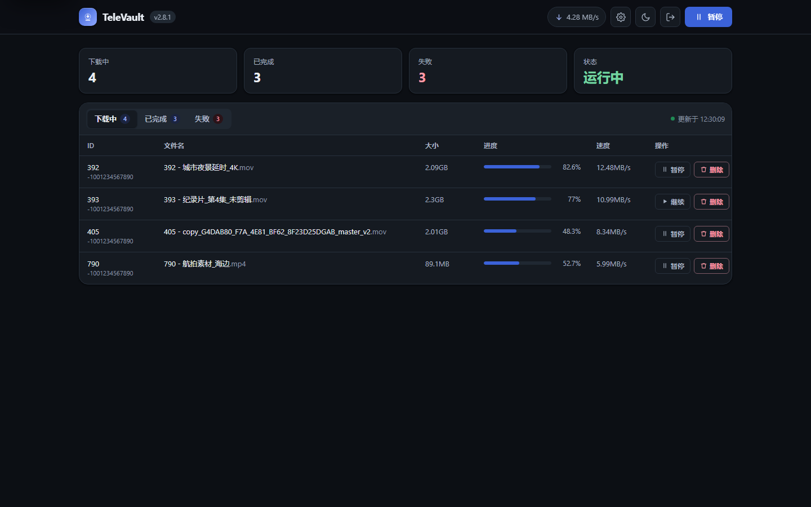
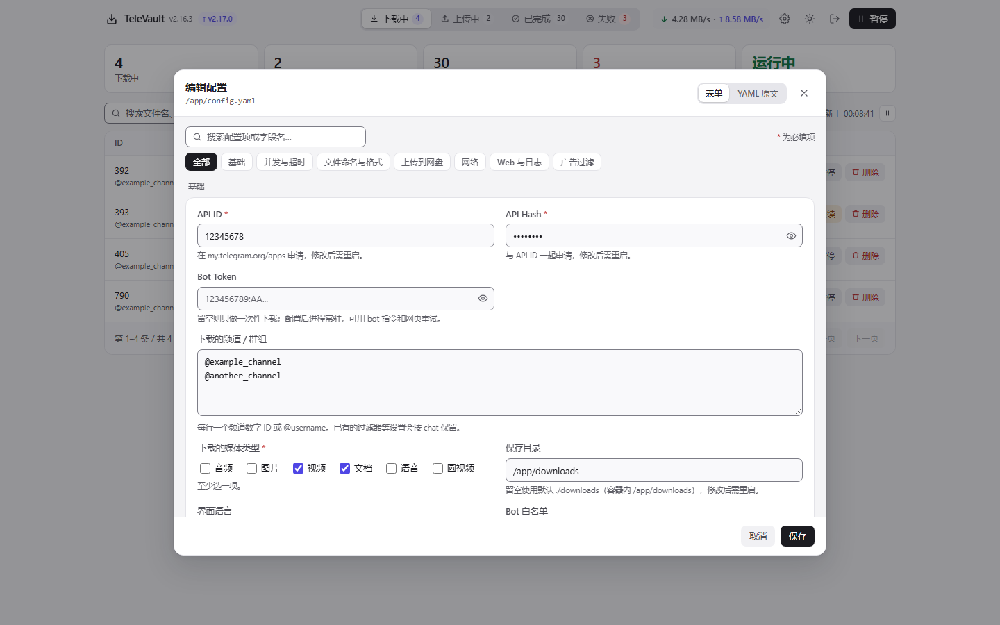
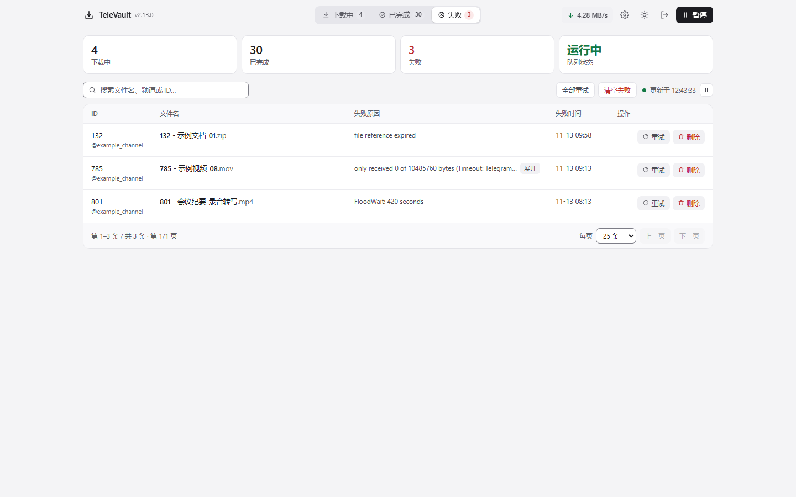
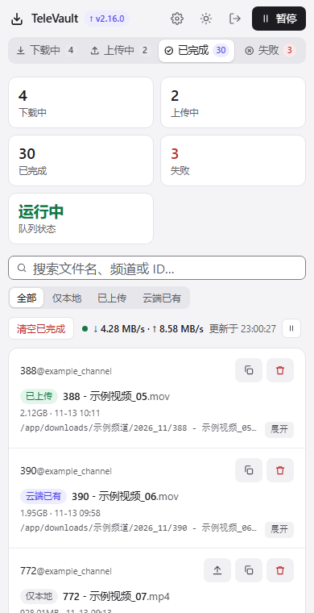

# tg-dl

> 基于 [tangyoha/telegram_media_downloader](https://github.com/tangyoha/telegram_media_downloader) 的修复分支。
> 保留原项目的全部功能（Telegram bot 指令、Web UI、rclone 上传、受保护内容下载），并持续修复实际使用中的问题。

当前版本：**v2.9.5**（版本号规则：MAJOR 表示破坏性改动或核心重写，MINOR 表示新增功能，PATCH 表示修复/打磨）

[](https://github.com/QCEnjoyLL/tg-dl/actions/workflows/docker-publish.yml)
[](https://github.com/QCEnjoyLL/tg-dl/releases/latest)
[](https://github.com/QCEnjoyLL/tg-dl/actions/workflows/unittest.yml)
[](LICENSE)

---

## 更新日志

> **从 v2.9.3 及更早版本升级（源码运行）**：`config.yaml` / `data.yaml` 在旧版本里是被 git 跟踪的，
> 直接 `git pull` 会因本地改动被拒绝，或被删掉。先备份再升级：
>
> ```bash
> cp config.yaml ~/config.yaml.bak && cp data.yaml ~/data.yaml.bak
> git checkout -- config.yaml data.yaml   # 让 git 能接受上游删除这两个文件
> git pull
> mv ~/config.yaml.bak config.yaml && mv ~/data.yaml.bak data.yaml
> ```
>
> Docker / compose 用户不受影响（配置本来就是挂载进容器的，从未进过镜像）。

逐条历史记录见 [CHANGELOG.md](CHANGELOG.md)；当前版本见顶部的 Release 徽章。

<details>
<summary><b>v2.9.5</b> — 构建镜像时自动发 Release</summary>

> Release 自动化上线后的第一个版本。v2.9.4 没有单独发布过，它的全部修复都包含在本版本里。

- **构建镜像时自动创建对应版本的 GitHub Release**：版本号只有 `utils/__init__.py` 一处来源，
  镜像标签、git tag、Release 不会再各说各话
- 镜像推送成功后才发 Release（失败不留半成品）；已存在的 Release 自动跳过，可安全重跑
- 手动推 `v*` tag 会校验与 `__version__` 是否一致；`CHANGELOG.md` 缺对应章节时在构建前就失败
- 镜像注入 `org.opencontainers.image.version`，`docker inspect` 可查版本；README 增加 Release 徽章
- 本版本同时包含 v2.9.4 的全部修复，见下一节

</details>

<details>
<summary><b>v2.9.4</b> — 已下载判定、配置原子写入、Web 鉴权加固</summary>

- **已存在的文件按字节数校验**：旧条件 `file_size or file_size == media_size` 会把任何非空残留文件当成已完成，半截文件永远不再重下
- **`file_formats` 支持按扩展名填**：`mp3` / `mov` / `docx` 不再因为 mime 子类型（`mpeg` / `quicktime` / 长串 `vnd.openxmlformats-...`）而整类文件被静默跳过
- **`config.yaml` / `data.yaml` 不再进 git**：仓库只跟踪 `config.yaml.example`，首次运行自动创建；`api_hash` 等密钥不会被误提交到公开仓库
- **配置写入改为原子写**：进程退出、磁盘写满、bind mount 场景下不再把 `config.yaml` 截断成空文件
- **安全加固**：`debug_web` 仅在 `127.0.0.1` 生效；`/login` 连续失败 5 次锁定 60 秒；运行期清空 `web_login_secret` 不再立刻解除鉴权
- **bot**：修复配置写到名为 `d` 的文件、非法过滤表达式仍继续建任务、`/remove_replace_ad` 逻辑反了等问题
- 其它：`media_types` 写成字符串不再导致所有消息被跳过；`get_chat_history_v2` 空页兜底不再下错范围；失败重试提示更准确；GB 级文件去重不再整文件读进内存

</details>

<details>
<summary><b>v2.9.3</b> — 失败原因可诊断（-500 TIMEOUT）</summary>

- 修复 **`[-500 TIMEOUT] ... caused by "upload.GetFile"` 反复失败、看不出原因**：
  Pyrogram fork 吞掉的真实异常现在会被捕获并写进失败原因，不再只报「下载中途中断，未生成文件」
- Telegram 侧 5xx 不再无意义地重开同一 offset，直接带原因失败；网络类错误按指数退避重试
- Web UI「失败」页新增**失败原因**列，并给出可执行的排查提示（MTU / 出口 IP / proxy / 并发）

</details>

<details>
<summary><b>v2.9.2</b> — 文档隐私清理</summary>

- **隐私清理**：README、`config.yaml` 模板、配置表单提示与预览页里的示例频道 ID、示例文件名
  统一换成通用占位数据，文档截图同步重拍，不再出现真实使用场景中的频道 / 文件信息

</details>

<details>
<summary><b>v2.9.1</b> — 大文件截断自动续传</summary>

- 修复**大文件下载中途截断却被误报为「文件引用过期」**：Pyrogram fork 会吞掉 `GetFile` 异常，
  只收到 5MB 的残缺文件会被当成下载完成，随后又被当成引用过期反复重试
- 新增 `pyrogram_guard`：数据流少于 `file_size` 时按 1MiB 边界自动续传，连续 3 次无进展才判定失败
- 下载失败原因会写入失败记录（传输中断 / 引用过期 / 其他异常），日志更准确

</details>

<details>
<summary><b>v2.9.0</b> — 任务列表分页、暂停/删除/重试修复</summary>

- **任务列表分页**：默认 25 条/页，可选 25 / 50 / 100 / 全部，每页条数会被记住
- 修复**全局暂停后列表没有暂停反馈**：新增暂停横幅、行内「已暂停 / 单条暂停」标签，速度显示 `—`
- 修复**删除任务无效**：Web 传的字符串 `chat_id` 与 int 键不匹配导致删除/重试/单条暂停全部静默失效，现在统一规范化
- 修复**失败任务无法重试**：同一类型问题；频道不在配置中时改用临时任务节点重试，并给出具体失败原因

</details>

<details>
<summary><b>v2.8.2</b> — 远端目录跨平台计算</summary>

- 远端目录计算与平台无关（先统一分隔符再 `dirname`/`relpath`），修复 Linux 下 Windows 风格路径目录丢失
- `remote_dir` 为 `115:` 这类裸远端时不再生成 `115://`

</details>

<details>
<summary><b>v2.8.1</b> — 云端已有文件判定</summary>

- 修复「云端已有文件却显示新文件上传成功、云端日期还是几天前」：上传前用 `rclone lsjson --stat`
  检查同名同大小文件并直接跳过（标记 **云端已有**）；上传后再核对远端，若服务端去重保留旧对象也改判为云端已有
- 修复 `save_path` 带斜杠/反斜杠时远端目录残留本地绝对路径、导致重复上传到新目录的问题
- 上传日志现在同时打印本地路径与完整远端路径，便于核对

</details>

<details>
<summary><b>v2.8.0</b> — Web UI 更名 TeleVault、上传结果可区分</summary>

- **Web UI 更名为 TeleVault**，换用新的归档 + 下载箭头 Logo（登录页、favicon 同步）
- **上传结果可区分**：「已完成」标签现在区分 `已上传`（真正传了新文件）、`云端已有`（rclone 判定远端已有相同文件、跳过上传）和 `仅本地`；
  bot 卡片与日志也会分别统计这两种成功
- 修复 `aligo` 上传适配器在上传时必然抛 `TypeError` 的问题

</details>

<details>
<summary><b>v2.7.4</b> — 完整 chat id、列表细节</summary>

- 任务列表显示完整 chat id（不再被截断）
- 「已完成」标签增加数量徽标
- 表格顶部对齐，ID/文件名/时间不再错位；「已上传 / 仅本地」状态移到文件名前

</details>

<details>
<summary><b>v2.7.3</b> — 保存配置后下载被静默跳过</summary>

- 修复「保存配置后所有下载都被跳过、日志里没有任何报错」：
  `file_formats` 被早期表单写成字符串 `"['all']"`、空 `chat_id` 被写成 `null`，导致整批任务静默失败。
  现在加载时会自动修复 `file_formats`、跳过空频道并给出明确日志。
- 若日志提示「config.yaml 中有一个 chat 缺少 chat_id」，到 Web UI「下载的频道 / 群组」重新填写一次即可。

</details>

<details>
<summary><b>v2.7.2</b> — YAML 原文编辑、file_formats 兼容</summary>

- 修复配置面板「YAML 原文」显示不全：文本框铺满对话框、自动换行、只有自身滚动
- `file_formats` 兼容列表与文本两种写法（`all` / `mp3, flac` / 粘贴的 `['all']` 都会正确写成列表）
- 只有旧版 `chat_id` 的配置会正确回填到频道列表

</details>

<details>
<summary><b>v2.7.1</b> — 静态缓存导致页面空白</summary>

- **修复旧静态缓存导致后台空白**：升级镜像后如果浏览器还在用上一版 `app.js`，会出现「连接异常：Cannot set properties of null」并且配置 / 退出按钮点不动。现在静态资源带 `?v=<版本号>`、HTML 禁止缓存，页面与后端版本不一致时会直接提示强制刷新。
- 界面初始化失败时顶部会显示错误原因和「重新加载」按钮，而不是静默失效。

> 升级后若仍显示旧界面，按一次 `Ctrl+F5`（Mac：`Cmd+Shift+R`）即可。

</details>

<details>
<summary><b>v2.7.0</b> — 配置表单</summary>

- **配置表单**：Web UI 的配置编辑从纯 YAML 文本框改成带中文说明的表单，已填写的项自动回填、未填写的留空；
  另保留「YAML 原文」标签页用于表单没覆盖的高级配置
- 字段级校验与逐项报错，保存时原子写入并保留未在表单中暴露的字段

</details>

<details>
<summary><b>v2.6.6</b> — Web UI 重做、版本号规范化</summary>

- **Web UI 重做**：全新视觉与交互，支持登录/退出登录、配置在线编辑、单任务暂停/恢复/删除
- **任务状态真实化**：下载完成后从「下载中」移入「已完成」，不再出现 bot 已成功而网页仍显示 100% 的僵尸任务；已完成列表有上限，不会无限吃内存
- **配置在线编辑**：Web UI 可直接编辑 `config.yaml`，密钥默认掩码显示；保存后立即生效的项会提示，需要重启的项会单独列出
- **CI 变严格**：测试 job 改为必过（不再是 `continue-on-error`），并修掉了上游遗留的测试腐化
- **版本号规范化**：去掉 `-fork.1` 后缀，改为语义化版本

</details>

---

## 为什么有这个分支

上游项目最后一次实质更新停在 v2.2.6（2026-03），但几个影响日常使用的问题一直没有修：

| 现象 | 根因 |
| --- | --- |
| Web 页面任务列表越堆越长，大量 0% 任务，失败任务不能重试也不能删除 | 进度表是一个只增不减的内存字典，失败记录永远停在最后百分比，页面也没有任何操作接口 |
| Telegram bot 的进度消息更新一阵子后彻底不动 | 进度卡片把所有任务拼进一条消息，超过 4096 字符后 `edit_message_text` 报错被静默吞掉，且失败前就已经把「已发送内容」写进缓存，之后不再重试 |
| 上传到网盘后本地文件不删除，硬盘被塞满 | 内置上传用 `rclone copy --ignore-existing`，远端已有同名文件时 rclone 直接跳过、不打印用于判定成功的那行输出，于是永远判定失败，永远不删本地 |
| 停止容器后失败任务丢失 | 仅在 `KeyboardInterrupt` 分支写 `data.yaml`，Docker 默认的 `SIGTERM` 会直接杀掉进程 |

这个分支把这四个问题都修了，并且把镜像构建改成了可用的 GitHub Actions 多架构流水线。

---

## 修复清单

### 1. rclone 上传后正确删除本地文件

`module/cloud_drive.py`

```diff
- rclone copy "<file>" "<remote_dir>/" --create-empty-src-dirs --ignore-existing --progress
- if "Transferred" in s and "100%" in s and "1 / 1" in s: os.remove(local)
+ rclone copyto "<file>" "<remote_dir>/<name>" --no-traverse --progress
+ if retcode == 0: os.remove(local)
```

- 改用 `copyto`，目标文件名明确，不再依赖目录语义
- 去掉 `--ignore-existing`，同名不同大小的文件会被正确覆盖，而不是被当成"已存在"
- 去掉 `--size-only`：同名同大小但内容不同的远端文件不会被误判为已上传后删掉本地
- 成功判定改为 **rclone 返回码**，不再解析进度文本；小文件秒传也能正确删除本地
- 子进程参数改为 argv 列表（不经过 shell），避免频道标题/文件名里的 `$()`、反引号造成命令注入
- 失败时打印 rclone 退出码和输出尾部，便于排查

### 2. bot 进度卡片不再假死

`module/pyrogram_extension.py` + `module/app.py`

- 下载、上传、云盘上传三个区块各自最多显示 5 条，其余折叠为 `… +N`
- 整体长度硬限制在 4000 字符以内
- **只有 Telegram 确认接收后才更新本地缓存**；编辑失败下一轮会重试，不会永久停更
- 单独处理 `MessageNotModified`，避免无意义告警
- 进度卡片刷新间隔由 1 秒放宽到 3 秒，显著减少 FloodWait

### 3. 失败任务可见、可重试、可删除

`module/download_stat.py` / `module/web.py` / `media_downloader.py` / `templates/index.html`

- 下载失败时立刻从「下载中」列表移除，不再留下永远 0% 的僵尸行
- 失败记录写入独立登记表，Web UI 新增 **Failed** 标签页，每 3 秒刷新
- 每一行可以 **重试**（重新入队，无需重启）或 **删除**（仅清除记录）
- 新增接口：`/get_failed_list`、`/retry_failed`、`/clear_failed`

### 4. 停止容器不再丢任务状态

- Dockerfile 增加 `STOPSIGNAL SIGINT`，`docker stop` 走 `KeyboardInterrupt` 分支，正常写回 `data.yaml`
- `docker-compose.yaml` 增加 `stop_signal: SIGINT` 和 `stop_grace_period: 2m`
- 失败任务同时保留在 `data.yaml` 的 `ids_to_retry` 中，下次启动仍会自动重排

---

## 快速开始

### 方式一：Docker（推荐）

```bash
docker pull ghcr.io/qcenjoyll/tg-dl:latest

mkdir -p ~/tg-dl/{downloads,log,sessions,temp}
cd ~/tg-dl
# config.yaml / data.yaml 已被 .gitignore 忽略（避免把 api_hash 等提交进仓库），
# 这里直接下载模板；data.yaml 需要先创建成文件，否则 bind mount 会建成目录。
curl -fsSL https://raw.githubusercontent.com/QCEnjoyLL/tg-dl/master/config.yaml.example -o config.yaml
touch data.yaml

# 编辑 config.yaml 填入 api_id / api_hash / chat
vi config.yaml

# 首次登录：前台运行，输入手机号和验证码，然后 Ctrl+C
docker run --rm -it \
  -v $PWD/config.yaml:/app/config.yaml \
  -v $PWD/data.yaml:/app/data.yaml \
  -v $PWD/sessions:/app/sessions \
  ghcr.io/qcenjoyll/tg-dl:latest

# 之后后台运行
docker run -d --name tg-dl --restart unless-stopped \
  -p 5000:5000 \
  -e TZ=Asia/Shanghai \
  -v $PWD/config.yaml:/app/config.yaml \
  -v $PWD/data.yaml:/app/data.yaml \
  -v $PWD/downloads:/app/downloads \
  -v $PWD/log:/app/log \
  -v $PWD/sessions:/app/sessions \
  -v $PWD/temp:/app/temp \
  -v $HOME/.config/rclone:/root/.config/rclone \
  --stop-signal SIGINT \
  ghcr.io/qcenjoyll/tg-dl:latest
```

> 若要通过 `http://<host>:5000` 远程打开 Web UI，请在 `config.yaml` 里设置 `web_login_secret`；未设置时进程只会监听容器内的 `127.0.0.1`，端口映射不会生效。建议再套一层 HTTPS 反向代理。

### 方式二：docker compose

```bash
git clone https://github.com/QCEnjoyLL/tg-dl.git
cd tg-dl
cp config.yaml.example config.yaml   # 模板不含任何真实密钥，仓库不跟踪 config.yaml
touch data.yaml
vi config.yaml        # 填 api_id / api_hash / chat
docker compose run --rm tg-dl     # 首次登录
docker compose up -d
```

`docker-compose.yaml` 已包含 `stop_signal: SIGINT` 和 rclone 配置挂载。

### 方式三：源码运行

```bash
git clone https://github.com/QCEnjoyLL/tg-dl.git
cd tg-dl
cp config.yaml.example config.yaml   # 首次运行会自动创建，但模板里是占位符
vi config.yaml                      # 填 api_id / api_hash / chat
pip3 install -r requirements.txt
python3 media_downloader.py
```

Web UI 默认监听 `http://<host>:5000`。**未设置 `web_login_secret` 时只会监听 `127.0.0.1`**，避免把无鉴权的下载队列暴露到局域网；需要远程访问请先设置密码（并建议放在 HTTPS 反向代理之后）。

---

## 配置说明

完整模板见仓库根目录 [`config.yaml.example`](config.yaml.example)（`config.yaml` 本身被 git 忽略，首次运行会自动从模板创建）。

### 必填

| 配置 | 说明 |
| --- | --- |
| `api_id` / `api_hash` | 在 [my.telegram.org/apps](https://my.telegram.org/apps) 申请 |
| `chat` | 要下载的频道/群组，`chat_id` 填写频道的数字 ID 或 `@username` |
| `save_path` | 本地保存目录，容器内默认 `/app/downloads` |
| `media_types` | `video` / `photo` / `document` / `audio` / `voice` / `video_note` |

### 并发（最容易踩坑的两项）

```yaml
# 同时下载的文件数。设太大会频繁 FloodWait，建议 2-3
max_download_task: 2

# Pyrogram 层的并发传输槽位，默认是 max_download_task * 5
# 想让整体更慢更稳，显式调小
max_concurrent_transmissions: 4
```

### 上传到网盘

```yaml
upload_drive:
  enable_upload_file: true
  upload_adapter: rclone
  remote_dir: "115:Telegram"      # rclone remote 名
  rclone_path: /app/rclone/rclone # Docker 镜像内已内置
  after_upload_file_delete: true  # 已修复，上传成功后一定删除
  before_upload_file_zip: false   # 建议关闭，避免额外汇总文件
```

> 上传成功后删除本地是**已修复**的逻辑；如果 rclone 返回非 0，文件会被保留并在日志中记录退出码，方便重试。
> 成功分两种：`upload new file ... success` 表示真正传了新文件，`remote already has ..., upload skipped` 表示云端已有相同文件、跳过了传输（同样算成功，且不会改动云端文件日期）。

### bot

```yaml
bot_token: "your_bot_token"
allowed_user_ids:
  - "me"
```

bot 进度卡片已限制长度，不会再因为任务多而停止更新。

### Web

```yaml
web_host: 0.0.0.0
web_port: 5000
web_login_secret: "改成你的密码"
# 仅在本机调试时打开：Werkzeug 交互式调试器可执行任意代码，
# 因此只在监听 127.0.0.1 时生效，绑定到 0.0.0.0 会被忽略并告警。
# debug_web: true
```

> **安全提示**：登录密码现在由浏览器直接提交到后端比较（旧的 AES 加密 key 硬编码在前端，只是混淆），所以务必通过 HTTPS 反向代理访问。`web_login_secret` 也支持 werkzeug 的 `pbkdf2:` 哈希。会话签名密钥默认每个进程随机生成；需要重启后保持登录可设置 `TDL_WEB_SECRET_KEY` 环境变量。

---

## Web UI

界面完全重写过，不再依赖 layui，静态资源从 ~880KB 降到 ~35KB（CSS/JS 合计，不含 logo 等文档图片）。
页面品牌名为 **TeleVault**（仓库名仍是 tg-dl），Logo 为「归档环 + 下载箭头」，登录页与 favicon 一致。

**登录页**



**浅色**



**深色**



**在线编辑配置**



**失败任务与失败原因**



**移动端**



功能：

- **明暗主题**：默认跟随系统，右上角可手动切换，选择记在 `localStorage`，刷新不丢
- **顶部概览**：下载中、已完成、失败数量，以及运行/暂停状态
- **三个标签**：下载中、已完成、失败；支持深链，`http://host:5000/#failed` 直接打开失败页
- **分页**：每页默认 25 条，可选 25 / 50 / 100 / 全部；切换标签各自记住页码，每页条数记在 `localStorage`
- **全局暂停提示**：点右上角「暂停」后顶部出现暂停横幅，下载中每一行标注 `已暂停` / `单条暂停`，速度冻结显示 `—`
- **单任务控制**：每个下载中的任务可以「暂停 / 继续 / 删除」，暂停只影响该条消息，不影响其他任务
- **失败可操作**：每行「重试」直接重新入队（无需重启）、「删除」清除记录（并同步从 `ids_to_retry` 移除，重启后不会再排队）
- **已完成**：显示完成时间与保存路径，可一键复制路径或删除记录；标签区分 `已上传`（新文件）、`云端已有`（远端已有、跳过上传）和 `仅本地`
- **登录 / 退出登录**：配置了 `web_login_secret` 时右上角出现退出按钮
- **在线改配置**：齿轮按钮打开配置面板，默认是带中文解释的表单（已填写的自动回填、未填写的留空），
  可按分组修改常见参数；顶部可切到「YAML 原文」编辑特殊配置。保存前校验，空值即删除该项，
  `api_hash` / `bot_token` / `web_login_secret` / 代理密码以掩码显示，不修改就不会覆盖；需要重启的项会在保存后列出
- **移动端适配**：窄屏自动隐藏次要列，表格自适应
- **可访问性**：键盘可完成全部操作（Tab 导航、方向键切换标签页、Esc 关闭配置面板、危险操作二次确认），焦点环、对比度和 `prefers-reduced-motion` 均已处理

接口（需要登录态）：

| 接口 | 方法 | 说明 |
| --- | --- | --- |
| `/get_download_list?already_down=false` | GET | 下载中的任务 JSON（含 `paused` 状态） |
| `/get_download_list?already_down=true` | GET | 已完成任务 JSON |
| `/get_failed_list` | GET | 失败任务 JSON |
| `/pause_task?chat_id=&message_id=` | POST | 暂停单条任务 |
| `/resume_task?chat_id=&message_id=` | POST | 恢复单条任务 |
| `/delete_task?chat_id=&message_id=` | POST | 删除任务（下载中会中止该文件） |
| `/retry_failed?chat_id=&message_id=` | POST | 重试单条，省略 `message_id` 则重试该 chat 全部 |
| `/clear_failed?chat_id=&message_id=` | POST | 删除失败记录 |
| `/get_config` | GET | 读取 `config.yaml` 原文（密钥掩码） |
| `/set_config` | POST | 校验并保存 YAML 原文，返回已生效 / 需重启的配置项 |
| `/get_config_form` | GET | 配置表单的字段定义、当前值和 YAML 原文 |
| `/set_config_form` | POST | 保存配置表单，返回字段级错误或已生效 / 需重启的配置项 |
| `/logout` | POST | 退出登录 |

> 重试是把消息重新放回下载队列，需要进程仍在运行。配置了 `bot_token` 时进程常驻，可以随时重试；纯一次性下载模式请直接重启程序，会从 `data.yaml` 的 `ids_to_retry` 重新排队。

### 配置热更新说明

保存配置后，以下项**立即生效**：`media_types`、`file_formats`、`file_path_prefix`、`file_name_prefix`、`file_name_prefix_split`、`hide_file_name`、`enable_download_txt`、`after_upload_telegram_delete`、`drop_no_audio_video`、`log_level`、`date_format`、`language`、广告过滤相关项、`upload_drive.*`、`web_login_secret`。

以下项需要**重启进程**：`api_id`、`api_hash`、`bot_token`、`chat`、`proxy`、`save_path`、`web_host`、`web_port`、`max_download_task`、`max_concurrent_transmissions`、`allowed_user_ids`、`start_timeout`。

### 本地预览界面

没有 Telegram 会话也能调 UI：

```bash
python preview/build.py
python -m http.server 8123 --directory .
# 打开 http://127.0.0.1:8123/preview/index.html?theme=dark
```

预览页用 mock 数据填充，`preview/` 和 `docs/` 都不会进镜像。

---

## 停止服务

**请务必优雅停止**，否则当前批次的失败任务不会写回 `data.yaml`：

```bash
docker stop tg-dl            # 镜像已设置 STOPSIGNAL SIGINT
# 或
systemctl stop tg-dl         # 服务里配置 KillSignal=SIGINT
```

宿主机直接跑源码时用 `Ctrl+C`，不要 `kill -9`。

---

## 构建与发布镜像

仓库自带 [`.github/workflows/docker-publish.yml`](.github/workflows/docker-publish.yml)：

- 推送到 `master` / `main`、打 `v*` tag、或在 Actions 页面手动触发时构建
- 自动推送到 **GHCR**：`ghcr.io/qcenjoyll/tg-dl`
- 版本号只有一处来源：`utils/__init__.py` 的 `__version__`。镜像标签、git tag、GitHub Release 全部由它生成，不会互相对不上
- 标签规则：`2.9.4`（当前版本）、`2.9`（minor 系列）、`latest`（默认分支）、分支名、`sha-xxxxxxx`
- 镜像内注入 `org.opencontainers.image.version` / `.revision`，`docker inspect` 一眼能看到版本
- 镜像推送成功后自动创建 **GitHub Release**：标题 `v2.9.4`，正文取自 `CHANGELOG.md` 同名章节 + 拉取命令
- Pull Request 只构建不推送，也不会创建 Release
- 构建前先跑 `python -m compileall` 做语法检查

### 发布新版本

1. 改 `utils/__init__.py` 里的 `__version__`（如 `2.9.5`）
2. 在 `CHANGELOG.md` 顶部加 `## v2.9.5` 章节（Release 正文就是这段内容）
3. 提交并推送到 `master` / `main`

工作流会自动构建镜像、打 `v2.9.5` tag 并创建 Release。版本号已存在的 Release 会跳过，重复推送不会报错。

> 手动推 `v*` tag 也可以，但 tag 必须和 `__version__` 一致，否则工作流会直接失败——避免发布说明和实际运行的代码对不上。

### 多架构

默认只构建 `linux/amd64`，因为 arm64 下 PyTgCrypto 需要在 QEMU 中编译，耗时很长。需要时在 Actions 里手动触发并填写：

```
linux/amd64,linux/arm64
```

Release 正文里的架构列表取自这次构建的实际参数。

### 拉取私有镜像

GHCR 包默认是私有的，二选一：

1. 在 GitHub → Packages → `tg-dl` → Package settings 里改为 Public
2. 先登录再拉取：

```bash
echo <你的PAT> | docker login ghcr.io -u QCEnjoyLL --password-stdin
```

PAT 需要 `read:packages` 权限。

---

## 常见问题

**Q：大文件下到一半总是失败，日志还写「文件引用过期」？**
v2.9.1 已修。底层 Pyrogram fork 会吞掉 `upload.GetFile` 的异常，把只下载了一部分的临时文件当成完成品返回；
旧版的大小校验又把它当成引用过期。现在下载器会在流提前结束时按 1 MiB 块边界自动续传，
只有连续 3 次完全没有进展才判定失败，并在失败记录里写明「只收到 X / 应为 Y 字节」。

**Q：日志一直刷 `[-500 TIMEOUT] ... caused by "upload.GetFile"`，这个文件一直下不下来？**
这是 **Telegram 存储节点取文件超时**，不是文件过期，也不是程序 bug；重试同一条会一直得到同样的结果。v2.9.3 起失败页会直接显示这条原因并给出提示，不再笼统地说「下载中途中断」。

常见原因和排查顺序：

1. **MTU 不匹配（云服务器 + Docker 最常见）**：登录、收发消息正常，但每个文件下载都在固定位置超时，通常是 Docker 网络 MTU 1500 与云厂商链路不一致，大包被丢弃。
   ```bash
   # 在宿主机上测试（能通则 MTU 正常，超时/丢包则说明链路有问题）
   ping -M do -s 1472 -c 3 149.154.167.51
   # 不行就依次试小一点的包，直到能通，例如 -s 1400
   ```
   给 Compose 网络加 MTU 后重启容器：
   ```yaml
   networks:
     default:
       driver_opts:
         com.docker.network.driver.mtu: "1400"
   ```
2. **并发过高被 Telegram 限速**：把 `max_download_task` 降到 1-2，`max_concurrent_transmissions` 降到 1-2，重启后再试。
3. **出口 IP 被限**：换个出口 IP，或在 `config.yaml` 配置代理（用户客户端和 bot 都会走）：
   ```yaml
   proxy:
     scheme: socks5
     hostname: 127.0.0.1
     port: 1080
   ```
4. **只有个别文件失败**：可能是该文件所在的存储 DC 暂时异常，隔一段时间重试，或换代理线路。

**Q：下载任务一直 0%，是不是卡住了？**
看 `log/tdl.log`。Web 的「下载中」标签只反映开始过下载的消息，队列里的大量消息不会同时推进；把 `max_download_task` 控制在 2-3 更稳。如果某条任务显示 100% 但一直不动，通常是该文件还在等待上传或收尾，可点「删除」清掉。

**Q：bot 说下载成功，网页还显示 100% 下载中？**
v2.6.6 已修：任务结束时会把记录从「下载中」移到「已完成」。旧版本请升级，或手动删除该行。

**Q：暂停单条任务会怎样？**
只影响这一条消息的传输进度，其他任务继续；「删除」会中止该文件并把它从列表中移除，重启后也不会再重新下载（如需重下请用失败页的重试或手动调整 `last_read_message_id`）。

**Q：升级后 bot 只回「Direct download…」，日志没有报错，下载也不开始？**
v2.7.0 / v2.7.1 的配置表单曾把 `file_formats` 写成文本 `"['all']"`、空频道写成 `null`，导致所有媒体格式被判定为「跳过」、频道初始化异常。升级到 **v2.7.3** 会自动修复 `file_formats` 并跳过空频道（日志会说明原因）；如果提示 `chat_id` 缺失，到 Web UI「下载的频道 / 群组」重新填写一次即可。

**Q：日志里的「Generating LALR tables」是什么？**
过滤器语法分析器（ply）的启动日志，正常现象，不是错误。

**Q：改配置会不会重启？**
大部分下载/上传行为项立即生效；`api_id`、`bot_token`、`chat`、`save_path`、端口等需要重启，保存后 Web UI 会列出需要重启的项。

**Q：后台一直显示「连接异常：Cannot set properties of null」，按钮也点不动？**
浏览器缓存了旧版 `app.js` 而后端已经升级。v2.7.1 起静态资源带版本号不会再发生；如果仍遇到，按一次 `Ctrl+F5`（Mac：`Cmd+Shift+R`）强制刷新即可，页面顶部也会出现同样的提示和「重新加载」按钮。

**Q：左上角有个「跳到主要内容」是什么？**
这是无障碍的跳过导航链接，只有用键盘 Tab 聚焦时才会出现，平时不会显示；回车会把焦点移到主内容区。

**Q：云端明明已经有这个文件，为什么还重新上传 / 显示「新文件」？**
v2.8.1 起上传前会先 `rclone lsjson --stat` 检查目标：同名且大小一致就跳过，标记为「云端已有」，云端文件日期不会被改动。如果仍显示新上传，请对照日志里的完整远端路径 —— 很可能是传到了另一个目录（例如 `save_path` 改动后路径前缀不同）。服务端按哈希去重、保留旧对象的情况也会被告警并改判为「云端已有」。

**Q：上传成功但本地没删？**
检查日志里是否有 `rclone upload failed, exit code ...`。修复后的逻辑只在返回码为 0 时删除；非 0 会保留文件并打印 rclone 输出尾部，按报错处理即可（常见是 WebDAV 423、磁盘配额、token 过期）。

**Q：重启后会不会重复下载？**
不会。`last_read_message_id` 和 `ids_to_retry` 存在 `data.yaml`，已完成的跳过，失败的重新排队。

**Q：支持 115 / OpenList / WebDAV 吗？**
支持。任何 rclone 能写的后端都可以，包括 WebDAV 挂载的 OpenList、115、阿里云盘等。

---

## 与上游的差异

- 修复上述四个问题（见上文修复清单）
- 修复 Web 写接口契约（真实 JSON）、认证绕过、rclone 命令注入、上传失败误删本地、任务卡死等 P0 问题
- 重写 Web UI 与登录页：明暗主题、概览卡片、单任务暂停/恢复/删除、在线配置编辑、退出登录、失败重试/删除、移动端适配、深链；移除 layui 与前端假 AES 加密，静态资源从 ~880KB 降到 ~35KB（CSS/JS 合计）
- 重写 Dockerfile：加 `tzdata`、`PYTHONUNBUFFERED`、OCI 标签、`STOPSIGNAL SIGINT`
- 重写镜像工作流：GHCR + buildx 缓存 + 语法检查，移除上游依赖 Docker Hub secrets 的旧流水线
- 测试 job 改为必过（`Tests`），修复上游遗留的测试腐化，并覆盖 Web 接口、rclone 参数、上传失败删除和任务终态
- 移除上游的 Windows PyInstaller 发布流水线（依赖已废弃的 `actions/create-release@v1`）
- 清理上游遗留配置：`dependabot.yml`（会自动开一堆依赖 PR）、`stale.yml`、`issue_label_bot.yaml`、issue 模板、`codecov.yml`、赞赏二维码图片

功能、配置项和 Telegram 侧行为与上游保持一致，可以直接替换使用；已有的 `config.yaml` / `data.yaml` / session 文件可以继续复用。

---

## 致谢

- 原始项目：[Dineshkarthik/telegram_media_downloader](https://github.com/Dineshkarthik/telegram_media_downloader)
- 中文增强与 bot/Web UI：[tangyoha/telegram_media_downloader](https://github.com/tangyoha/telegram_media_downloader)
- Telegram 客户端：[Pyrogram](https://github.com/pyrogram/pyrogram)（本分支使用 tangyoha 的 patch 版）

## License

MIT，与上游一致。请只下载你有权保存的内容，并遵守 Telegram 服务条款与当地法律。
